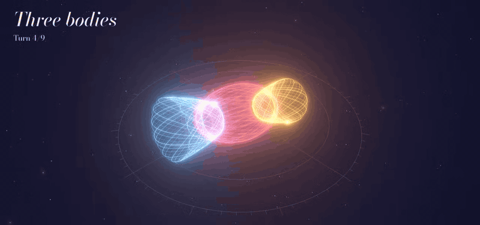
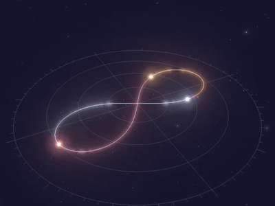
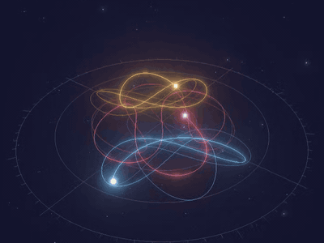
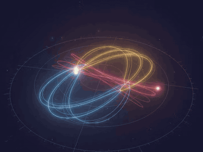
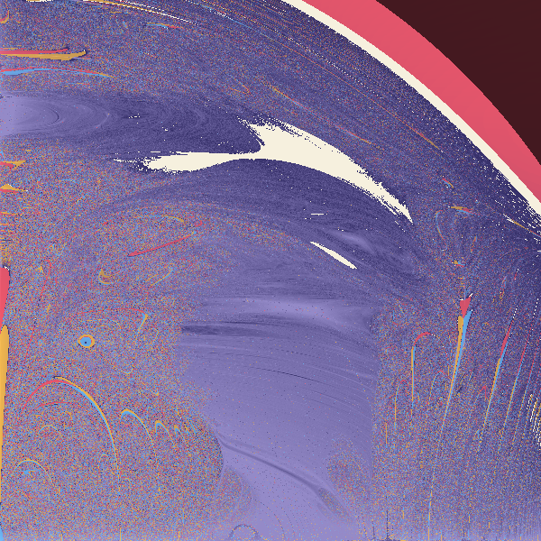

**English** | [简体中文](README.zh-CN.md)

# Three bodies

**Periodic orbits of the equal-mass three-body problem: a numerical study from scratch, with computer-assisted proofs and an interactive atlas.**

[](https://three-body.shadowhusky-london.uk)

### ▶ Live atlas: https://three-body.shadowhusky-london.uk

In Liu Cixin's novel, the Trisolarans live under three suns and never know whether tomorrow brings a gentle
Stable Era or a Chaotic Era that fries the planet. This project takes on their homework: three equal masses,
Newton's law of gravity, and nothing borrowed.

## At a glance

| | |
|---:|---|
| **345,146** | initial conditions surveyed. About 98 in 100 end in chaos or break-up. |
| **324** | periodic orbits found: 171 planar, 153 three-dimensional. |
| **128** | 3D orbits absent from the largest published catalogue (2025, 1,504 entries). |
| **28** | 3D orbits proved to exist by computer, each unique within 10⁻³³ of our numbers. |
| **20** | families that tie several 3D orbits together, 19 catalogue entries among them. |
| **13** | 3D families traced back to the planar orbit they grow from. |

## Orbits

Every clip is recorded from the live atlas. The simulation runs in your browser.

<table>
  <tr>
    <td width="33%"></td>
    <td width="33%"></td>
    <td width="33%"></td>
  </tr>
  <tr>
    <td><b>Figure-eight.</b> Three bodies chase each other along one curve. Stable.</td>
    <td><b>Moth I.</b> A planar orbit of period 14.9. Stable.</td>
    <td><b>Dragonfly.</b> Planar, with close passes. Unstable.</td>
  </tr>
  <tr>
    <td></td>
    <td></td>
    <td></td>
  </tr>
  <tr>
    <td><b>Yin-yang I.</b> Planar, period 17.3. Unstable.</td>
    <td><b>3D family, rotation 1/4.</b> Computed to order. Stable, existence proved.</td>
    <td><b>A fast-rotating 3D orbit.</b> Not in the 2025 catalogue. Existence proved.</td>
  </tr>
</table>

## Order and chaos

<table>
  <tr>
    <td width="33%"></td>
    <td width="33%"></td>
    <td width="33%"></td>
  </tr>
  <tr>
    <td><b>A Chaotic Era.</b> Most systems end like this: one body is ejected and never returns.</td>
    <td><b>The stability map.</b> Each pixel is one system. Colour shows which body gets ejected; ivory marks the rare stable islands. Click any pixel in the atlas to watch it.</td>
    <td><b>Braids.</b> Stretch time into the third dimension and the three paths weave a braid.</td>
  </tr>
</table>

## Findings

1. **Chaos is the rule.** Within 200 time units, 43% of bound systems eject a body and 55% are still bound but
   chaotic. Only 1 to 2% are regular. The Trisolarans were right to dehydrate.
2. **324 periodic orbits.** A search based on time-reversal symmetry, refined with Newton's method, found 171
   planar and 153 three-dimensional periodic orbits. 128 of the 3D ones are not in the 2025 catalogue of Li and
   Liao. Orbits that are in it agree to 11 digits, with the same stability label in all 27 shared cases.
3. **3D orbits come in families.** Seen from a rotating frame, each 3D periodic orbit belongs to a continuous
   family, and the closed orbits are its members with a rational rotation per cycle. Of 144 short-cycle orbits
   (103 ours, 41 from the catalogue), 60 belong to 20 families with several members. The largest, with 15 members,
   is the family first computed by Michalodimitrakis in 1981. Members can be computed to order at any rational
   rotation.
4. **The 3D families grow out of planar orbits.** Of 14 families followed down to zero angular momentum, 13 end
   exactly on a planar periodic orbit: the Schubart orbit, the figure-eight, Butterfly I, Yin-yang I, Moth III and
   eight unnamed ones, with periods agreeing to better than one part in a million. One family joins two different
   planar orbits. For the figure-eight and the Schubart orbit this link is known; for the others we found no
   earlier statement in the papers we read.
5. **28 orbits proved to exist.** Interval arithmetic and a Krawczyk test prove existence and local uniqueness for
   nine members of the 1981 family and nineteen orbits absent from the catalogue. The method contains Lagrange's
   exact solution, as it must. In the novel this took an emperor and thirty million soldiers waving flags. We used
   one Mac. No sophons interfered.
6. **A formula for the calm, a code for the chaos.** Regular orbits fit a quasi-periodic series; chaotic ones do
   not, but the sequence of who passes between the other two pins down the initial condition like a postal address.

## Run it

```sh
cd app
npm install
npm run dev
```

<details>
<summary>Reproduce the research (macOS, needs <code>clang</code> and <a href="https://docs.astral.sh/uv/">uv</a>)</summary>

```sh
cd research
uv venv --python 3.13 .venv
uv pip install --python .venv/bin/python numpy scipy pillow python-flint
.venv/bin/python exp1_validate.py                            # validate the integrator
.venv/bin/python exp2_map.py 600 200                         # stability map (the slow one)
.venv/bin/python exp3_planar_orbits.py                       # planar periodic orbits
.venv/bin/python exp6_spatial_orbits.py 2000000 20 2 0.2     # 3D periodic orbits
.venv/bin/python exp8_family.py                              # the rotating family
.venv/bin/python exp5_code.py                                # symbolic dynamics
.venv/bin/python exp4_formulas.py                            # quasi-periodic fits
.venv/bin/python exp7_lifetimes.py 6000 2000                 # lifetime distribution
.venv/bin/python exp10_prove.py family                       # existence proofs
.venv/bin/python exp11_verify.py                              # independent checks
.venv/bin/python exp12_families.py && .venv/bin/python exp13_origins.py   # families and their planar parents (after the catalogue step below)
.venv/bin/python export_app.py                               # export everything to the app
```

Each script's docstring states the question it answers. Search stages are cached in `research/results/`.

To repeat the catalogue comparison, fetch the published data first:

```sh
mkdir -p external/li-liao-3d && cd external/li-liao-3d
curl -O https://raw.githubusercontent.com/sjtu-liao/three-body/main/initial-condition-of-3D-periodic-orbits.txt
cd ../.. && .venv/bin/python -I exp9_read_catalogue.py external/li-liao-3d/initial-condition-of-3D-periodic-orbits.txt
.venv/bin/python exp9_catalogue.py
```

</details>

## What is where

| Path | What it is |
|---|---|
| `app/` | The atlas (three.js + Vite). `src/physics.js` is the integrator in JavaScript; `src/i18n.js` holds the English and Chinese text. |
| `research/core/tb.c` | Taylor-series integrator in C. |
| `research/periodic.py` | Periodic-orbit search using reversing symmetries. |
| `research/family.py` | Continuation of relative periodic orbits. |
| `research/proof.py` | Validated integration and Krawczyk test (Arb ball arithmetic). |
| `research/exp*.py` | One script per experiment. |
| `research/results/` | Orbits, proofs and summary numbers as JSON. |

## Caveats

- Equal masses only, and two families of symmetric initial conditions.
- "Absent from the catalogue" means absent from that one list, not necessarily unknown.
- One prediction failed: we expected the survival fraction of unstable triples to decay as t^(−2/3) and measured
  −0.48.
- The family analysis covers orbits with short cycles. Many families were not followed to both ends, so some of
  the 100 found may be the same family.
- The proof code is our own and has not been independently reviewed.

<details>
<summary>References</summary>

- M. Šuvakov and V. Dmitrašinović, "Three classes of Newtonian three-body planar periodic orbits", *Phys. Rev. Lett.* 110, 114301 (2013).
- X. Li and S. Liao, "More than six hundred new families of Newtonian periodic planar collisionless three-body orbits", *Sci. China Phys. Mech. Astron.* 60, 129511 (2017).
- X. Li and S. Liao, "Discovery of 10,059 new three-dimensional periodic orbits of general three-body problem", [arXiv:2508.08568](https://arxiv.org/abs/2508.08568) (2025).
- M. Michalodimitrakis, "The families C1V and M2V of the three-dimensional general three-body problem", *Astron. Astrophys.* 93, 212 (1981).
- M. Hénon, "A family of periodic solutions of the planar three-body problem, and their stability", *Celest. Mech.* 13, 267 (1976).
- A. Chenciner and R. Montgomery, "A remarkable periodic solution of the three-body problem in the case of equal masses", *Ann. Math.* 152, 881 (2000).
- Liu Cixin, *The Three-Body Problem* (2008), for the homework assignment.

</details>
