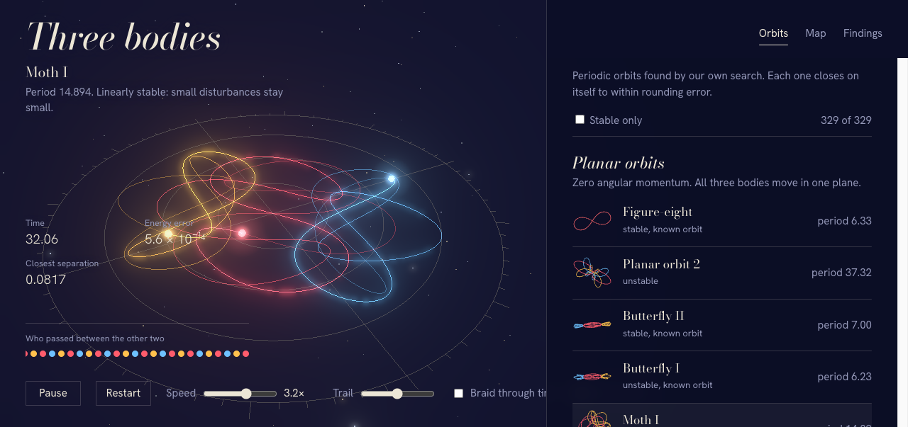
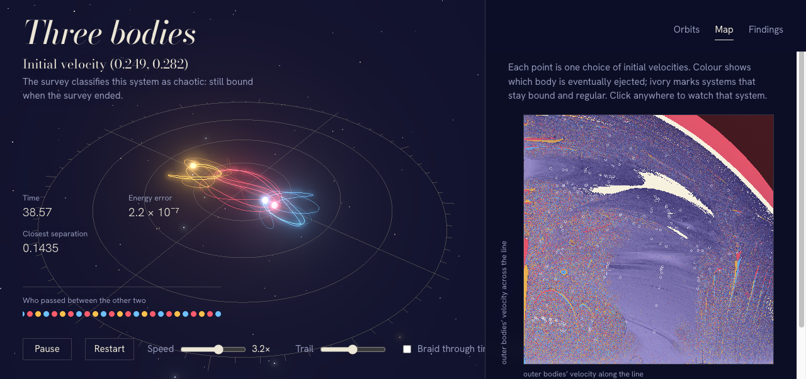
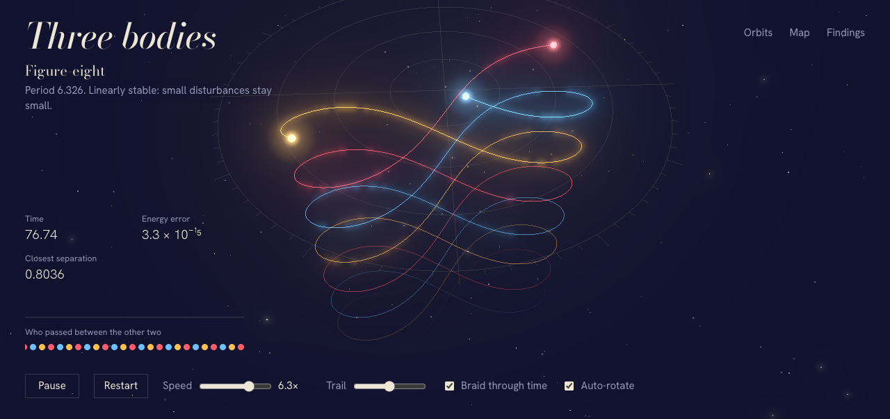

# Three bodies

**An interactive atlas of the gravitational three-body problem, computed from scratch.**

[](https://three-body.shadowhusky-london.uk)

**Live atlas: https://three-body.shadowhusky-london.uk**

In Liu Cixin's novel, the Trisolarans live under three suns and can never tell whether tomorrow brings a gentle
Stable Era or a Chaotic Era that fries the planet. This project takes on their homework: three equal masses,
Newton's law of gravity, and nothing borrowed. Every number below comes from code in this repository.

## The short version

| | |
|---:|---|
| **345,146** | initial conditions surveyed. About 98 in 100 end in chaos or break-up. The Trisolarans were right to dehydrate. |
| **324** | periodic orbits found: 171 planar and 153 three-dimensional. |
| **128** | of the 3D orbits are absent from the largest published catalogue (Li & Liao 2025, 1,504 equal-mass entries). |
| **28** | orbits whose existence is proved by computer, each unique within 10⁻³³ of the listed initial conditions. |
| **1** | continuous family of rotating 3D orbits traced from end to end. It turns out to be a 1981 family, and four entries of the 2025 catalogue are members of it. |

## What you can do in the atlas

| Browse 324 periodic orbits | Click anywhere on the stability map | Watch orbits braid through time |
|---|---|---|
|  |  |  |
| Famous ones (figure-eight, butterflies, moths) and hundreds more, each tagged stable or unstable. | Every pixel is a different choice of initial velocities. Colour shows which body gets ejected; ivory marks the rare stable islands. | Stretch time into the third dimension and the three paths become a braid. |

The simulation running in your browser is the same Taylor-series integrator used for the research, ported to
JavaScript and checked against the C version to 10⁻¹².

## What we found

**Chaos is the rule.** Within 200 time units, 43% of bound systems eject a body and 55% are still together but
chaotic. Only 1 to 2% are regular, in a small island around the figure-eight orbit.

**But there are 324 worlds where the calendar works.** A symmetry-based search with Newton refinement found 171
planar and 153 three-dimensional periodic orbits, each closing to rounding error. Twelve of the planar ones are
the well-known named orbits; the sixty shortest orbits of the published 3D catalogue also close in our integrator.

**One family, any rhythm you order.** Nine stable 3D orbits found separately turned out to be the same solution
rotating at different rates. Following it as a relative periodic orbit (periodic in a rotating frame) gives a
continuous family: every rational rotation rate yields an orbit that closes exactly, and the irrational ones never
repeat yet are known for all time from a single cycle. The family was first computed by Michalodimitrakis in
1981. We found it independently, and add where it starts (at the collinear Schubart orbit), how far it stays
stable, and the members that close in the inertial frame.

**Proved, not just simulated.** For 28 orbits, validated numerics (interval arithmetic plus a Krawczyk test) prove
that an exact solution exists and is unique within 10⁻³³ of our numbers. In the novel this kind of calculation
took an emperor and thirty million soldiers waving flags. We used one Mac. No sophons interfered.

**A formula for the calm, a code for the chaos.** Regular orbits can be written as a quasi-periodic Fourier series
that extrapolates ten times beyond the fitted span. Chaotic ones cannot, but their syzygy sequence (who passes
between the other two) works like a postal address for the initial condition.

**One prediction that failed.** A Kepler's-third-law argument says the survival fraction of unstable triples should
decay as t^(−2/3). We measured −0.48 out to t = 2000. It steepens with time, but it is not confirmed.

## Run it

The atlas:

```sh
cd app
npm install
npm run dev
```

The research (macOS, needs `clang` and [uv](https://docs.astral.sh/uv/)):

```sh
cd research
uv venv --python 3.13 .venv
uv pip install --python .venv/bin/python numpy scipy pillow python-flint
.venv/bin/python exp1_validate.py                            # validate the integrator
.venv/bin/python exp2_map.py 600 200                         # stability map (the slow one)
.venv/bin/python exp3_planar_orbits.py                       # planar periodic orbits
.venv/bin/python exp6_spatial_orbits.py 2000000 20 2 0.2     # 3D periodic orbits
.venv/bin/python exp8_family.py                              # the rotating family
.venv/bin/python exp5_code.py                                # symbolic dynamics
.venv/bin/python exp4_formulas.py                            # quasi-periodic fits
.venv/bin/python exp7_lifetimes.py 6000 2000                 # lifetime distribution
.venv/bin/python exp10_prove.py family                       # existence proofs
.venv/bin/python export_app.py                               # export everything to the app
```

Each script's docstring states the question it answers. Search stages are cached in `research/results/`, so
reruns resume.

To repeat the catalogue comparison, fetch the published data first:

```sh
mkdir -p external/li-liao-3d && cd external/li-liao-3d
curl -O https://raw.githubusercontent.com/sjtu-liao/three-body/main/initial-condition-of-3D-periodic-orbits.txt
cd ../.. && .venv/bin/python -I exp9_read_catalogue.py external/li-liao-3d/initial-condition-of-3D-periodic-orbits.txt
.venv/bin/python exp9_catalogue.py
```

## What is where

```
app/                 the atlas (three.js + Vite)
  src/physics.js     Taylor-series integrator in JavaScript
  public/data/       orbits, stability map, fitted formulas
research/
  core/tb.c          Taylor-series integrator in C
  periodic.py        periodic-orbit search using reversing symmetries
  family.py          continuation of relative periodic orbits
  formula.py         frequency analysis of regular orbits
  proof.py           validated integration and Krawczyk test (Arb ball arithmetic)
  exp*.py            one script per experiment
  results/           orbits, proofs and summary numbers as JSON
```

## Caveats

- Equal masses only, and two families of symmetric initial conditions.
- "Absent from the catalogue" means absent from that one list. The 1981 family shows the older literature holds
  more than the modern catalogues record.
- The proof code is our own and has not been independently reviewed.

## References

- M. Šuvakov and V. Dmitrašinović, "Three classes of Newtonian three-body planar periodic orbits", *Phys. Rev. Lett.* 110, 114301 (2013).
- X. Li and S. Liao, "More than six hundred new families of Newtonian periodic planar collisionless three-body orbits", *Sci. China Phys. Mech. Astron.* 60, 129511 (2017).
- X. Li and S. Liao, "Discovery of 10,059 new three-dimensional periodic orbits of general three-body problem", [arXiv:2508.08568](https://arxiv.org/abs/2508.08568) (2025).
- M. Michalodimitrakis, "The families C1V and M2V of the three-dimensional general three-body problem", *Astron. Astrophys.* 93, 212 (1981).
- M. Hénon, "A family of periodic solutions of the planar three-body problem, and their stability", *Celest. Mech.* 13, 267 (1976).
- A. Chenciner and R. Montgomery, "A remarkable periodic solution of the three-body problem in the case of equal masses", *Ann. Math.* 152, 881 (2000).
- Liu Cixin, *The Three-Body Problem* (2008), for the homework assignment.
