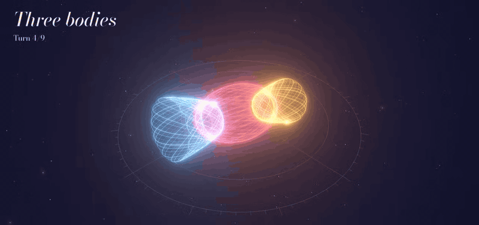
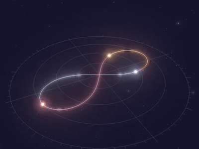
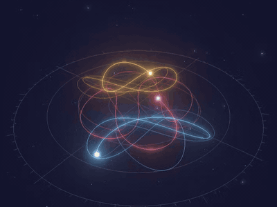
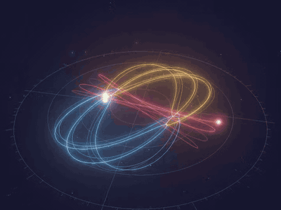
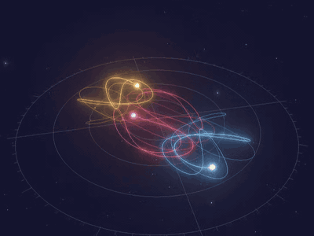
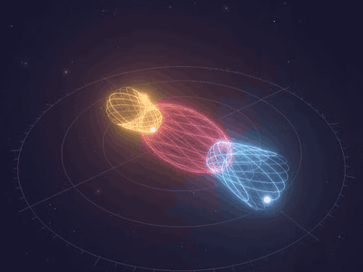
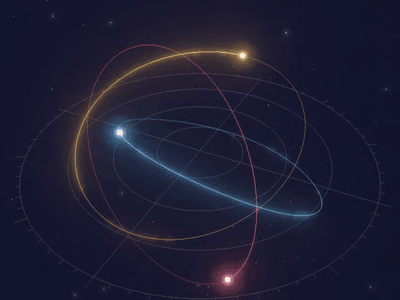
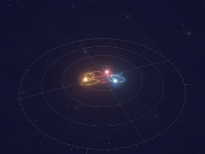
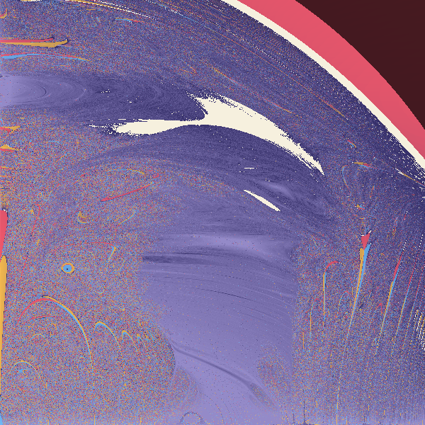

[English](README.md) | **简体中文**

# 三体

**从零算起的引力三体问题交互式图册。**

[](https://three-body.shadowhusky-london.uk/?lang=zh)

### ▶ 在线图册：https://three-body.shadowhusky-london.uk/?lang=zh

在刘慈欣的《三体》里，三体人头顶三颗太阳，永远不知道明天是温和的恒纪元，还是把行星烤焦的乱纪元。这个项目替他们做了这道作业：三个质量相等的天体，牛顿的万有引力定律，其余什么都不借用。

## 一眼看懂

| | |
|---:|---|
| **345,146** | 组初始条件被逐一巡查。一百个里大约九十八个以混沌或解体收场。 |
| **324** | 条周期轨道：171 条平面的，153 条三维的。 |
| **128** | 条三维轨道不在目前最大的公开目录里（2025 年，共 1,504 条）。 |
| **28** | 条轨道由计算机证明存在，每一条都在我们给出的数字 10⁻³³ 以内，且唯一。 |

## 轨道

每段动画都录自在线图册，模拟就在你的浏览器里运行。

<table>
  <tr>
    <td width="33%"></td>
    <td width="33%"></td>
    <td width="33%"></td>
  </tr>
  <tr>
    <td><b>8 字形。</b>三个天体沿同一条曲线互相追逐。稳定。</td>
    <td><b>飞蛾 I。</b>周期 14.9 的平面轨道。稳定。</td>
    <td><b>蜻蜓。</b>平面轨道，天体之间会近距离擦过。不稳定。</td>
  </tr>
  <tr>
    <td></td>
    <td></td>
    <td></td>
  </tr>
  <tr>
    <td><b>阴阳 I。</b>平面轨道，周期 17.3。不稳定。</td>
    <td><b>三维轨道族，转速 1/4。</b>按需算出。稳定，存在性已证明。</td>
    <td><b>一条快速旋转的三维轨道。</b>不在 2025 年目录里。存在性已证明。</td>
  </tr>
</table>

## 秩序与混沌

<table>
  <tr>
    <td width="33%"></td>
    <td width="33%"></td>
    <td width="33%"></td>
  </tr>
  <tr>
    <td><b>乱纪元。</b>大多数系统都是这个结局：一个天体被抛出，再也不回来。</td>
    <td><b>稳定性图谱。</b>每个像素是一个系统。颜色表示哪个天体被抛出，象牙色是罕见的稳定小岛。在图册里点任意一个像素，就能看它怎么演化。</td>
    <td><b>辫子。</b>把时间拉成第三个维度，三条轨迹就编成了一条辫子。</td>
  </tr>
</table>

## 发现

1. **混沌是常态。** 在 200 个时间单位内，43% 的系统抛出一个天体，55% 仍然束缚在一起但已混沌，只有 1% 到 2% 是规则的。三体人脱水是对的。
2. **324 个历法管用的世界。** 利用对称性搜索，再用牛顿法精修，我们找到 171 条平面周期轨道和 153 条三维周期轨道，每一条都闭合到舍入误差。
3. **一个轨道族，任选节奏。** 九条稳定的三维轨道，其实是同一个解以不同的转速旋转。任意有理数转速都给出一条精确闭合的轨道。这个轨道族最早由 Michalodimitrakis 在 1981 年算出；我们独立找到了它，并补上了它从哪里开始、稳定到哪里为止，以及那些精确闭合的成员。
4. **是证明，不只是模拟。** 区间算术加上 Krawczyk 检验，证明了其中 28 条轨道确实存在。在小说里，这要动用一位皇帝和三千万挥舞旗子的士兵。我们只用了一台 Mac。没有智子干扰。
5. **静处有公式，乱处有密码。** 规则轨道可以拟合成拟周期级数，预测到拟合区间的十倍之外。混沌轨道不行，但“谁从另外两个中间穿过”的符号序列，可以像邮政地址一样锁定初始条件。

## 运行

```sh
cd app
npm install
npm run dev
```

<details>
<summary>复现研究（macOS，需要 <code>clang</code> 和 <a href="https://docs.astral.sh/uv/">uv</a>）</summary>

```sh
cd research
uv venv --python 3.13 .venv
uv pip install --python .venv/bin/python numpy scipy pillow python-flint
.venv/bin/python exp1_validate.py                            # 验证积分器
.venv/bin/python exp2_map.py 600 200                         # 稳定性图谱（最慢的一步）
.venv/bin/python exp3_planar_orbits.py                       # 平面周期轨道
.venv/bin/python exp6_spatial_orbits.py 2000000 20 2 0.2     # 三维周期轨道
.venv/bin/python exp8_family.py                              # 旋转轨道族
.venv/bin/python exp5_code.py                                # 符号动力学
.venv/bin/python exp4_formulas.py                            # 拟周期拟合
.venv/bin/python exp7_lifetimes.py 6000 2000                 # 寿命分布
.venv/bin/python exp10_prove.py family                       # 存在性证明
.venv/bin/python export_app.py                               # 把结果导出给图册
```

每个脚本开头的文档字符串都写明了它要回答的问题。搜索的各个阶段缓存在 `research/results/` 里。

要重做与已发表目录的比对，先下载目录数据：

```sh
mkdir -p external/li-liao-3d && cd external/li-liao-3d
curl -O https://raw.githubusercontent.com/sjtu-liao/three-body/main/initial-condition-of-3D-periodic-orbits.txt
cd ../.. && .venv/bin/python -I exp9_read_catalogue.py external/li-liao-3d/initial-condition-of-3D-periodic-orbits.txt
.venv/bin/python exp9_catalogue.py
```

</details>

## 目录结构

| 路径 | 内容 |
|---|---|
| `app/` | 图册（three.js + Vite）。`src/physics.js` 是 JavaScript 版积分器，`src/i18n.js` 是中英文文案。 |
| `research/core/tb.c` | C 语言写的泰勒级数积分器。 |
| `research/periodic.py` | 利用可逆对称性搜索周期轨道。 |
| `research/family.py` | 相对周期轨道的延拓。 |
| `research/proof.py` | 带严格误差界的积分与 Krawczyk 检验（Arb 球算术）。 |
| `research/exp*.py` | 每个实验一个脚本。 |
| `research/results/` | 轨道、证明和汇总数字（JSON）。 |

## 局限

- 只研究了等质量的情形，以及两类对称的初始条件。
- “不在目录里”指不在那一份目录里，不代表从未有人见过。
- 有一个预言落空了：我们预计不稳定三体系统的存活比例按 t^(−2/3) 衰减，实测指数是 −0.48。
- 证明程序是我们自己写的，尚未经过他人独立审阅。

<details>
<summary>参考文献</summary>

- M. Šuvakov and V. Dmitrašinović, "Three classes of Newtonian three-body planar periodic orbits", *Phys. Rev. Lett.* 110, 114301 (2013).
- X. Li and S. Liao, "More than six hundred new families of Newtonian periodic planar collisionless three-body orbits", *Sci. China Phys. Mech. Astron.* 60, 129511 (2017).
- X. Li and S. Liao, "Discovery of 10,059 new three-dimensional periodic orbits of general three-body problem", [arXiv:2508.08568](https://arxiv.org/abs/2508.08568) (2025).
- M. Michalodimitrakis, "The families C1V and M2V of the three-dimensional general three-body problem", *Astron. Astrophys.* 93, 212 (1981).
- M. Hénon, "A family of periodic solutions of the planar three-body problem, and their stability", *Celest. Mech.* 13, 267 (1976).
- A. Chenciner and R. Montgomery, "A remarkable periodic solution of the three-body problem in the case of equal masses", *Ann. Math.* 152, 881 (2000).
- 刘慈欣，《三体》（2008）：作业的出题人。

</details>
